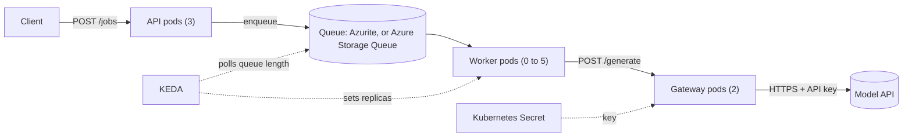
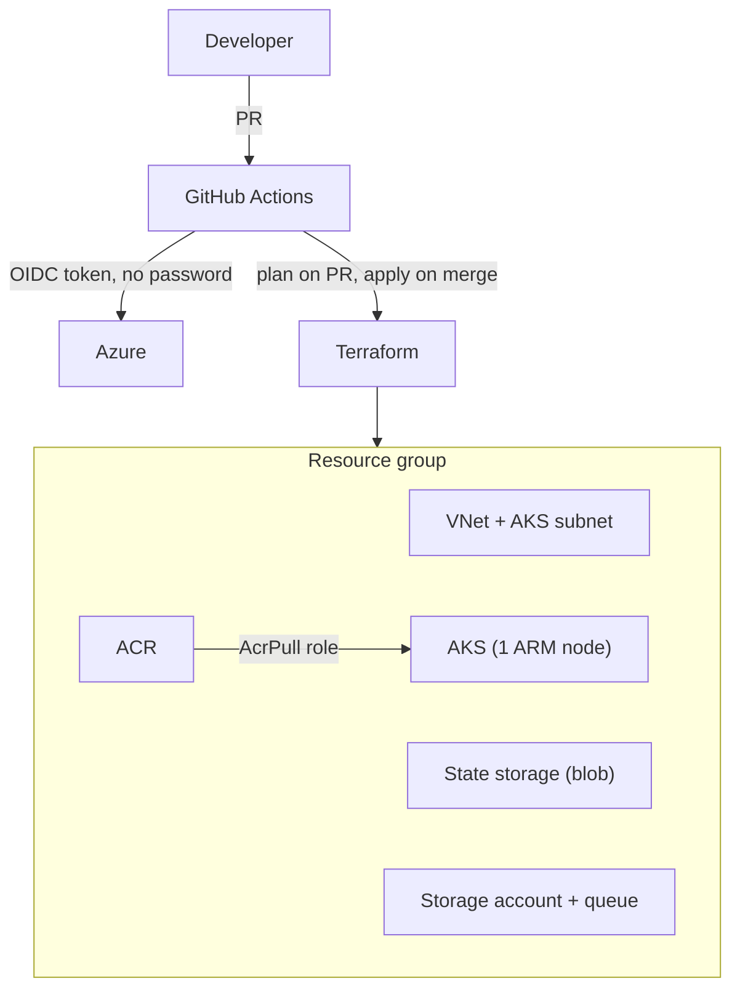

# Project 4: AI Agent Platform on Kubernetes (AKS)

A queue-driven AI workload platform: an API accepts jobs and returns immediately, worker pods process them in the background, KEDA scales the workers from zero based on queue depth, and a gateway is the only component that holds the model API key. Infrastructure is Terraform on Azure (AKS, ACR, VNet), deployed through GitHub Actions with OIDC (no stored cloud credentials).

> Status: the model call is stubbed (the gateway returns a canned reply), and the AKS test ran against Azurite (a queue emulator). The Azure Storage Queue is provisioned by Terraform but not wired into the app yet.

## Architecture

## What is in the repo

| Path | Contents |
|---|---|
| `api/` | Flask API, worker, and gateway (one image, three start commands) |
| `k8s/` | ConfigMap, Deployments, Services, Azurite, KEDA ScaledObject |
| `terraform/` | VNet, AKS, ACR, storage queue; remote state in Azure Blob |
| `.github/workflows/` | Terraform plan on PR, apply on merge to `main` |

## Key decisions and trade-offs

| Decision | Why | Trade-off |
|---|---|---|
| Queue between API and workers | The API replies 202 at once; slow model calls happen later; bursts wait in the queue | One more moving part |
| KEDA instead of CPU-based HPA | A worker waiting on a model API uses almost no CPU, so CPU is the wrong signal; KEDA scales on queue length and to zero | Extra operator to install and run |
| Gateway between workers and the model | One place for the key, retries, rate limits and logging; swap providers without touching workers | Extra network hop |
| One image, three commands | One build and one tag for API, worker and gateway | Changing any of them rebuilds the image |
| Azurite locally and on AKS | Same SDK and code as Azure Storage Queue, no cloud cost while developing | Azurite's key is public; not for production |
| ARM node (D2ps_v6) | Images built on an M1 Mac run as-is; no multi-arch build | Quota had to be checked first (several families were at 0) |
| OIDC for CI | Short-lived tokens, trust limited to this repo's `main` and PRs; nothing stored | Subject format must match exactly (GitHub now includes numeric IDs) |
| AKS and ACR parked (`*.tf.off`) | Apply on merge would recreate billable resources; only cheap resources go through CI | Deploying AKS is a deliberate rename |
| Local first (kind), then AKS | Free iteration; AKS used only for the final proof, then destroyed | Secrets and images must be recreated each time |

## Results

- Probes, rolling updates and rollback tested locally (kind).
- Burst test on AKS: 10 jobs queued with zero workers, KEDA scaled the worker Deployment up to 4 pods, the backlog drained, and pods exited cleanly on SIGTERM and scaled back to zero.
- Pipeline: PR runs `fmt`, `validate` and `plan`; merge applies.

## Run it

Local (kind): create the cluster, build and `kind load` the image, create the two Secrets, apply `k8s/`, install KEDA with Helm, apply the ScaledObject.
AKS: rename the parked Terraform files, apply, push the image to ACR, create the Secrets, apply `k8s/` with the registry image name, install KEDA. Destroy afterwards.

Secrets are never committed; they are created with `kubectl create secret`.

## Next steps (hardening)

- Wire the apps to the Azure Storage Queue; later use identity-based access instead of connection strings.
- Key Vault with Workload Identity on AKS instead of Kubernetes Secrets.
- NetworkPolicies so only workers reach the gateway and only API and workers reach the queue.
- Narrower role than Owner for the pipeline identity; required approval before apply; Checkov scan on PRs.
- Replace the stubbed model reply with a real provider call, plus retries and rate limiting in the gateway.
- Observability (Azure Monitor, alerts) and a RAG pipeline.
